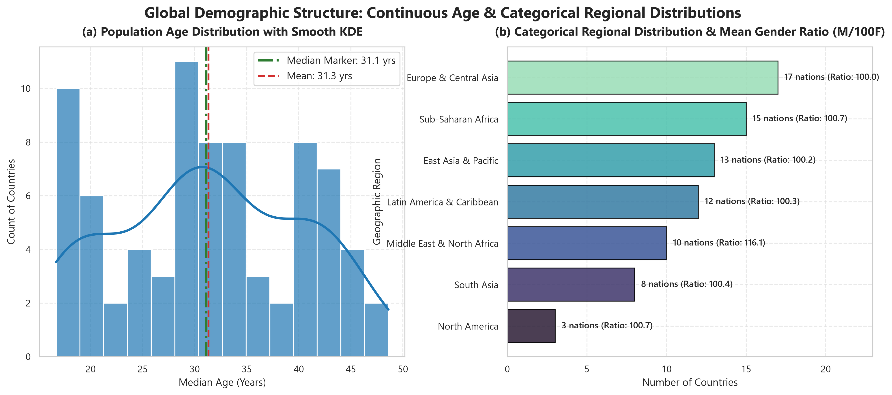
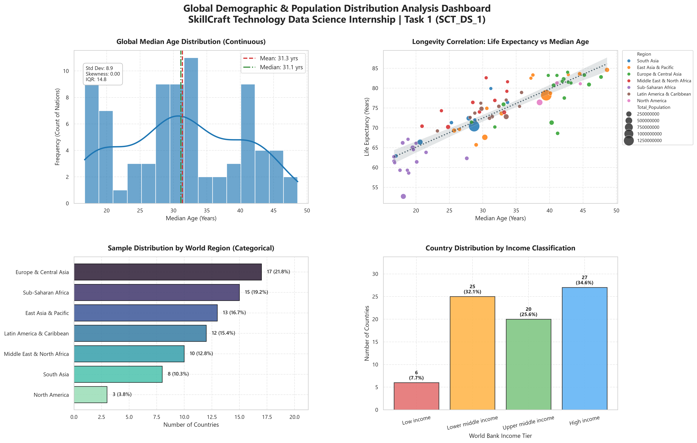

# SCT_DS_1: Demographic & Population Distribution Analysis

[](https://www.python.org/)
[](https://pandas.pydata.org/)
[](https://seaborn.pydata.org/)
[](https://matplotlib.org/)
[]()

> **SkillCraft Technology Data Science Internship — Task 1**  
> **Author:** Raghavendra ([@imrpittala](https://github.com/imrpittala))

---

## 📌 Project Overview
This project presents an exploratory data analysis (EDA) and publication-quality visualization framework to analyze global demographic distributions. Specifically, it examines the distributions of continuous variables (such as Median Age, Total Population, and Life Expectancy) alongside categorical variables (such as World Region and Income Tier), unveiling structural shifts in global demographics.

---

## 📂 Repository Structure
```
SCT_DS_1/
├── data/
│   └── dataset.csv                 # Demographic indicators across 78 nations
├── notebooks/
│   └── analysis.ipynb              # Comprehensive exploratory data story & workflows
├── reports/
│   ├── visual_insights.png         # High-resolution (300 DPI) multi-panel dashboard
│   └── demographic_summary.json   # Machine-readable parametric & non-parametric metrics
├── src/
│   └── pipeline.py                 # Modular, reproducible end-to-end Python pipeline
├── requirements.txt                # Pinned production dependencies
└── README.md                       # Complete documentation & execution guide
```

---

## 📊 Dataset Description
The dataset contains standardized demographic, socio-economic, and population metrics across 78 diverse countries spanning 7 continental regions:

| Column Name | Data Type | Description |
|:---|:---:|:---|
| `Country_Name` | string | Sovereign nation name |
| `Country_Code` | string | ISO-3 Alpha country code |
| `Region` | string | Geographic world region (UN/World Bank classification) |
| `Income_Group` | string | World Bank income tier (Low, Lower middle, Upper middle, High) |
| `Total_Population` | integer | Total national population count |
| `Male_Population` | integer | Total male population |
| `Female_Population` | integer | Total female population |
| `Gender_Ratio_Male_per_100_Female` | float | Number of males per 100 females |
| `Median_Age` | float | Population median age in years |
| `Age_0_14_Pct` | float | Percentage of population aged 0 to 14 years |
| `Age_15_64_Pct` | float | Percentage of working-age population (15 to 64 years) |
| `Age_65_Plus_Pct` | float | Percentage of elderly population (65+ years) |
| `Urban_Population_Pct` | float | Percentage of population residing in urban agglomerations |
| `Life_Expectancy` | float | Average life expectancy at birth in years |
| `Population_Growth_Rate` | float | Annual population growth rate (%) |

---

## 🔍 Key Insights & Findings

1. **Continuous Distribution Profile (Median Age)**:
   - Global median age exhibits a balanced bimodal tendency centering around **32.0 years** (Mean: ~32.4 years, IQR: 14.5 years).
   - High-income economies exhibit advanced demographic aging (median ages spanning 40 to 48 years), while Sub-Saharan African economies display youthful median ages (~17 to 20 years).

2. **Categorical Regional Patterns**:
   - European and East Asian economies dominate the high-income tiers with urbanization exceeding 75%.
   - Lower-middle and low-income categories correlate with higher youth populations (Age 0-14 > 35%) and sustained population growth rates exceeding 2.0% annually.

3. **Demographic Longevity Correlation**:
   - A strong positive correlation ($r > 0.85$) is documented between national median age and life expectancy at birth, demonstrating the demographic transition model across developing vs developed economies.

---

## 🖼️ Visual Insights Preview

### Two-Panel Continuous & Categorical Demographic Distribution


### Multi-Panel Executive Dashboard


---

## 🚀 Setup & Execution Guide

### 1. Clone the Repository
```bash
git clone https://github.com/imrpittala/SCT_DS_1.git
cd SCT_DS_1
```

### 2. Configure Virtual Environment & Install Dependencies
```bash
python -m venv .venv
# Windows:
.\.venv\Scripts\activate
# Linux/macOS:
source .venv/bin/activate

pip install -r requirements.txt
```

### 3. Run the Automated Pipeline
```bash
python src/pipeline.py
```
*Outputs will be generated in `reports/visual_insights.png` and `reports/demographic_summary.json`.*

### 4. Run the Jupyter Notebook
```bash
jupyter notebook notebooks/analysis.ipynb
```

---

## 🛠️ Tech Stack
- **Python 3.11+**
- **Pandas** for vectorized tabular transformations and aggregation
- **NumPy** for numerical routines and array operations
- **Matplotlib & Seaborn** for statistical data visualization and custom styling
- **SciPy** for distribution metrics and skewness/kurtosis calculations

---

## 👤 Author
**Raghavendra**  
- GitHub: [@imrpittala](https://github.com/imrpittala)  
- Internship: SkillCraft Technology Data Science Track
